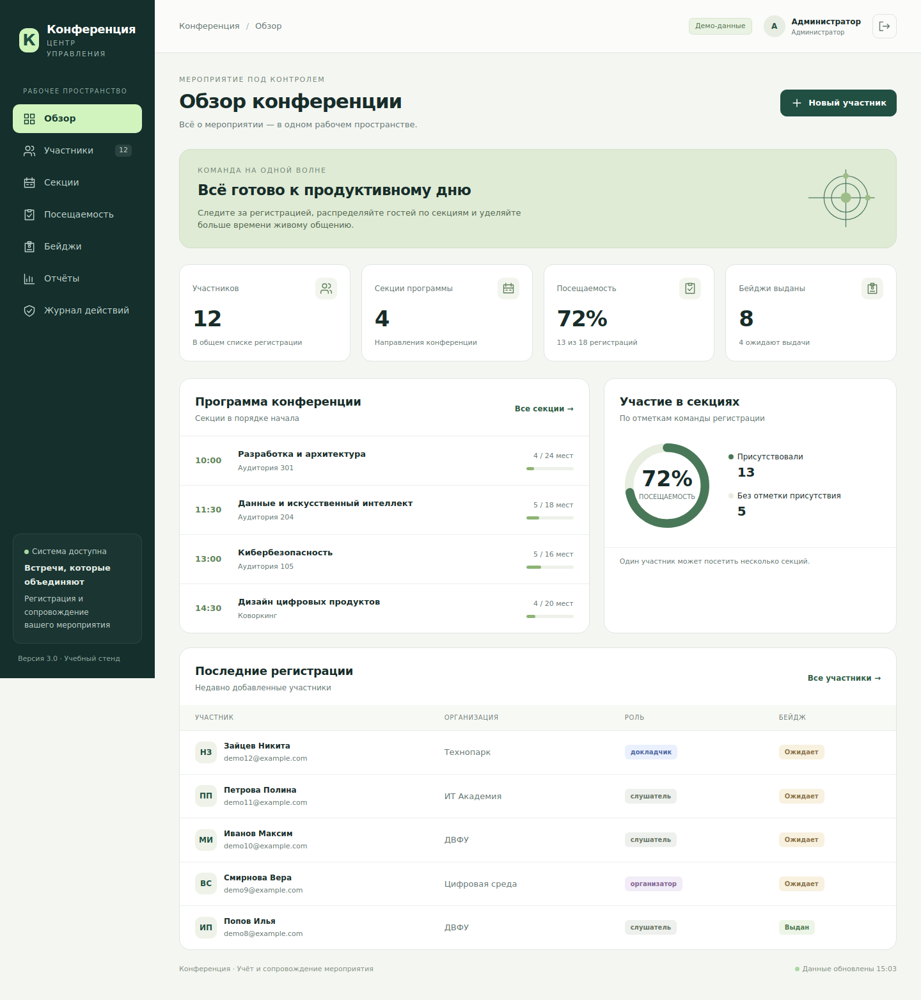
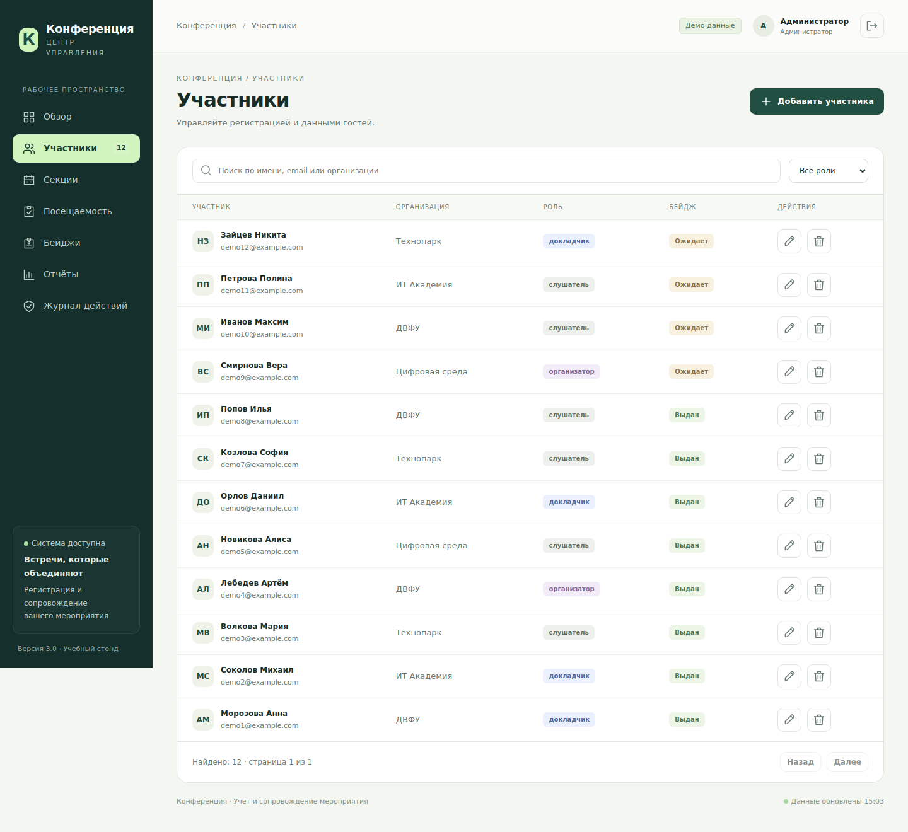
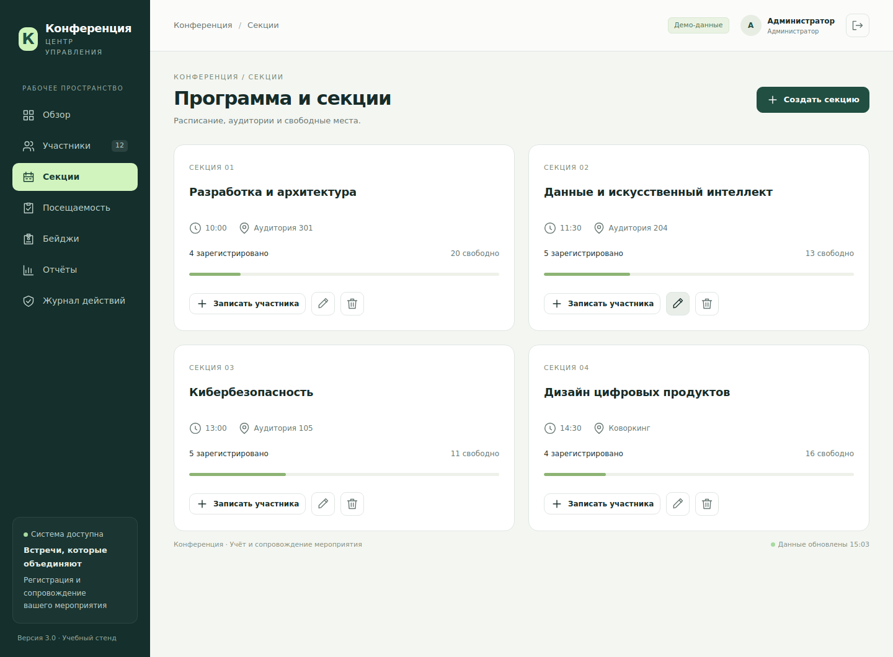

<h1 align="center">Конференция</h1>

<p align="center"><strong>Участники, программа и посещаемость в одном рабочем пространстве</strong></p>

<p align="center">
  
  
  
  
</p>

<p align="center">
  <a href="#возможности">Возможности</a> ·
  <a href="#быстрый-запуск">Быстрый запуск</a> ·
  <a href="#демо-аккаунты">Демо-аккаунты</a> ·
  <a href="#документация">Документация</a>
</p>

<p align="center">
  <a href="screenshots/screenshots/dashboard.png">
    
  </a>
</p>

Веб-приложение для оргкомитета конференции. Проект продолжает УП.02 и доработан в рамках УП.03 «Сопровождение и обслуживание программного обеспечения компьютерных систем».

## Возможности

| Раздел | Что можно сделать |
| --- | --- |
| **Участники** | Добавить или отредактировать карточку, найти участника по имени и отфильтровать список по роли. Email проверяется на уникальность. |
| **Секции** | Составить программу с временем, аудиторией и лимитом мест. Свободные места видны в карточке секции. |
| **Посещаемость** | Записать участника на секцию, отметить визит или отменить запись. |
| **Бейджи** | Напечатать один бейдж или все сразу и отдельно отметить выдачу. |
| **Отчёты** | Посмотреть сводки по посещениям и заполненности, экспортировать данные в CSV и JSON или загрузить JSON для восстановления с проверкой перед записью. |
| **Сопровождение** | Посмотреть журнал действий, проверить состояние приложения, сохранить и восстановить копию SQLite. |

<details>
<summary>Скриншоты рабочих экранов</summary>

| Участники | Программа и секции |
| --- | --- |
| [](screenshots/screenshots/participants.png) | [](screenshots/screenshots/sections.png) |

[Посещаемость](screenshots/screenshots/attendance.png) · [Бейджи](screenshots/screenshots/badges.png) · [Отчёты](screenshots/screenshots/reports.png) · [Мобильный интерфейс](screenshots/screenshots/mobile-dashboard.png) · [Все скриншоты](screenshots/screenshots/)

</details>

## Быстрый запуск

Для локального демо нужны **Python 3.12** и браузер. Скачайте проект или клонируйте его с GitHub.

```bash
git clone https://github.com/Aktden/UP03_Conference.git
cd UP03_Conference
```

> [!NOTE]
> В текущей ветке `main` Python-модули лежат в `src/`. Скрипты запуска и сборки ищут их в корне. Выполните команды ниже из корня свежей локальной копии. Первая команда копирует туда нужные модули.

### Windows · PowerShell

```powershell
Copy-Item -Path .\src\*.py -Destination .
.\scripts\setup.bat
.\scripts\run.bat
```

### Linux и macOS

```bash
cp src/*.py .
make setup PYTHON=python3.12
make run
```

<details>
<summary>Запуск без Make</summary>

```bash
cp src/*.py .
python3.12 -m venv .venv
.venv/bin/python -m pip install -r requirements.txt
test -f .env || cp .env.example .env
.venv/bin/python main.py
```

</details>

Откройте <http://127.0.0.1:8000>. При первом запуске приложение создаёт `data/conference.db` и заполняет её вымышленными данными. База сохраняется между запусками. Для остановки сервера нажмите **Ctrl+C**.

[Документация API в Swagger UI](http://127.0.0.1:8000/docs) · [Проверка состояния приложения](http://127.0.0.1:8000/api/health)

## Демо-аккаунты

| Роль | Логин | Демо-пароль | Доступ |
| --- | --- | --- | --- |
| Администратор | `admin` | `DemoAdmin!2026` | Все разделы, экспорт, импорт и журнал действий. |
| Оператор | `operator` | `DemoOperator!2026` | Работа с участниками, записями на секции, посещениями и бейджами. |
| Наблюдатель | `viewer` | `DemoViewer!2026` | Программа и агрегированные сводки. |

## Проверки и сборка

Команды выполняются после подготовки локальной копии и установки зависимостей через `setup.bat` или `make setup`.

| Действие | Windows | Linux и macOS |
| --- | --- | --- |
| Линтер, форматирование и тесты с порогом покрытия 80% | `.\scripts\check.bat` | `make check` |
| Сборка релизного архива `release/conference-v3.0.0.zip` и контрольной суммы SHA-256 | `.\scripts\build.bat` | `make build` |

<details>
<summary>Проверка интерфейса с Playwright</summary>

**Windows**

```powershell
.\.venv\Scripts\python.exe -m playwright install chromium
.\.venv\Scripts\python.exe scripts\ui_smoke.py
```

**Linux и macOS**

```bash
.venv/bin/python -m playwright install chromium
.venv/bin/python scripts/ui_smoke.py
```

Скрипт запускает отдельный сервер с временной демо-базой.

</details>

## Структура проекта

| Путь | Содержимое |
| --- | --- |
| [`src/`](src/) | Приложение FastAPI, настройки, модели Pydantic, работа с SQLite и контроль доступа. |
| [`routers/`](routers/) | Маршруты API для авторизации, участников, секций, посещений, бейджей и отчётов. |
| [`frontend/`](frontend/) | Адаптивный интерфейс на HTML, CSS и JavaScript со стилями печати. |
| [`scripts/`](scripts/) · [`tests/`](tests/) | Запуск, сборка, резервное копирование и автоматизированные проверки. |
| [`docs/`](docs/) · [`stages/`](stages/) | Инструкции, отчёты и материалы шести этапов практики. |

## Документация

| Материал | Содержание |
| --- | --- |
| [Установка и конфигурация](docs/INSTALL.md) | Переменные окружения, типовые ошибки и перенос базы УП.02. |
| [Развёртывание](DEPLOYMENT.md) | Docker Compose, рабочий режим, перезапуск и откат. |
| [Резервное копирование](docs/BACKUP_RESTORE_REPORT.md) | Сохранение и проверка копии SQLite, восстановление в отдельный файл. |
| [Безопасность](docs/SECURITY.md) | Разграничение доступа, сессии и требования к рабочему режиму. |
| [План тестирования](docs/TEST_PLAN.md) · [История изменений](docs/CHANGELOG.md) | Сценарии проверки и доработки версии 3.0.0. |
